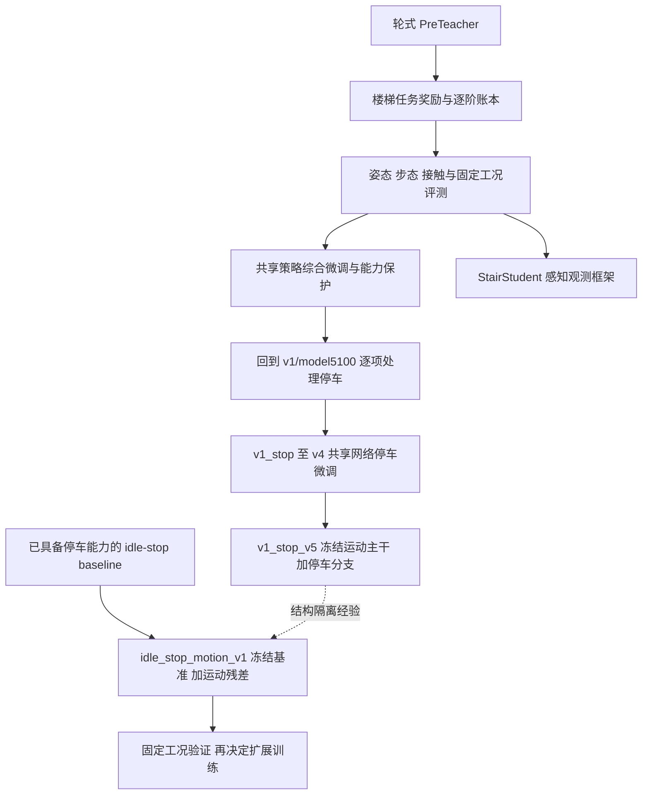

# M20 楼梯与多地形策略技术改进路线

整理日期：**2026-10-19**，时区 Asia/Shanghai。范围：本工程现有源码、保存的实验报告，以及本次会话已确认的改进记录。结构采用“总体路线 → 分阶段改进 → 当前技术实现 → 验收与后续路线”。

当前教师工程统一记为 **v0 基线**；文中的 v1/v2/v3/v4/v5 是历史实验或 profile 标记，保留原名以追溯，不是当前工程发布序号。相关材料已按时间和主题整理到 [test_docs 索引](test_docs/README.md)。当前常用程序见 [v0 工具清单](../scripts/tools/README.md)：明确不用于当前教师且无保留代码依赖的 7 个专项脚本已删除并备份，仍使用或用途不确定的 27 个程序保留原内容；训练实现不变。

**公开范围。** 按用户要求，`docs/` 仅本文件随 GitHub 仓库发布。文中 `test_docs/`、`.scratch/`、训练日志和模型等证据引用保留本地位置，未随本文件上传；新克隆不能直接打开这些本地材料。当前代码目录和工具说明随工程发布。

## 一、总体路线与当前结论

### 1.1 项目目标

在保留 M20 轮式基础运动能力的前提下，逐步获得可靠的楼梯通行、多地形零指令停车、较小的上下楼横移，以及下楼入口合理的前后轮间距和步态。评价同时覆盖任务完成、稳定性、姿态、真实碰撞、动作变化和计算开销，不能只以总奖励或模型迭代编号排名。

总体路线经历了五次重点转移：

1. **基础任务可学习**：从轮式预训练迁移，修复上楼稀疏奖励、重试与台阶记账，避免“存活时间长但不爬楼”。
2. **姿态和步态可测量**：统一逐阶历史，区分承重/摆动，建立前腿折叠、后腿前倾、同阶/跳阶和接触指标。
3. **能力退化可约束**：对照已验证 checkpoint，增加参考策略、critic 预热、固定工况和运行版本追踪；识别奖励与控制器同时变化的风险。
4. **停车与运动目标解耦**：从共享网络停车微调，发展到 v5 的零指令专用分支；发现单靠加大惩罚和延长训练不足以处理状态覆盖、信息缺失和目标冲突。
5. **围绕更好的 baseline 定向修正**：使用已有停车能力的 `teacher_baseline_idle_stop.pt`，冻结其输出映射，仅学习非零指令运动残差，把重点转向直行和入口避碰。

图中最后两条是不同实验方向，不是要求把停车分支和运动分支叠加运行。Student 也不是已完成的真机蒸馏系统。

### 1.2 时间与证据口径

- 日期优先取报告标题、版本常量、启动清单和已记录 run 时间，不把文件最后修改时间直接当作算法开发时间。
- 同一天有多轮改动时，按明确的版本和 run 区分。没有独立时间证据的当前代码变化，标为“截至 2026-10-19 已存在”，不补造小时或日期。
- “代码实现”只说明逻辑存在；“CPU 检查”验证函数语义；“Isaac/GPU 短测”验证接线和更新；“MuJoCo 固定回放”只覆盖给定初态；“用户交互观察”也有其初态与控制版本范围。
- 本文引用的历史数字均来自对应记录，**不是 2026-10-19 重新运行的结果**。历史全套源码、模型或日志可能已迁移/不再保留，不能保证仅按旧命令即可逐字重放。
- 本次只整理文档，没有重新训练或给当前候选补做行为验收。新 baseline 的停车表现来自用户既有验证；尚无材料证明运动残差训练已经消除横移和碰撞。

### 1.3 版本名称必须区分

| 名称系列 | 时间与含义 | 不能混淆的地方 |
| --- | --- | --- |
| `refine_stop_heading_posture_v1` | 2026-10-15 综合修正起点 | 其中 model5100 是后续 v1 兼容停车实验的运动参照 |
| 综合改进 v2、路线/配对 v3、下降/停车 v4 | 2026-10-15—16，仍采用原 244 维 actor 接口 | 某个日志目录叫 v5，不代表运行版本就是 `v1_stop_v5` |
| `v1_stop`、`v1_stop_v2/v3/v4` | 2026-10-17，恢复 v1 兼容目标后研究停车 | v2/v3 的辅助标记不进入 actor MLP；仍共享主网络参数 |
| `v1_stop_v5` | 2026-10-17，新增 24 维停车控制输入和专用分支 | 这是网络结构变化，不能当成单纯奖励升级 |
| `idle_stop_motion_v1` | 版本标记含 20261017；截至 2026-10-19 的当前实现 | 换用停车 baseline，新增非零指令运动残差；不是 v5 停车分支续训 |

### 1.4 改进时间总表

| 时间 | 阶段 | 核心改进 | 证据与状态 |
| --- | --- | --- | --- |
| 2026-09-29—30 | 基础训练记录 | 楼梯教师/轮式预训练，建立 actor 迁移方式 | 训练路径与后续分析记录可追溯，不代表所有任务已验收 |
| 2026-10-01 | 首次上楼失败诊断 | 抬腿增量信用、重试、前后轴进度、前进不足代价 | CPU 反例与 Isaac 16 环境检查；当时未证明新策略学会上楼 |
| 2026-10-02 | 步态修正 | 同阶事件/停留、后腿折叠、紧凑转向、量化回放 | 记录明确区分已有模型基线与新奖励预期 |
| 2026-10-03 | 上楼前腿折叠 | 支撑/摆动分阶段包络与极端折叠约束 | 实际旧模型轨迹＋函数检查＋短接线验证 |
| 2026-10-06 | 工程与输入修复 | 统一奖励模块、兼容旧导入、修复按住键输入 | AST/数值等价与 Isaac 检查；键盘窗口行为修复 |
| 2026-10-07 | 姿态与多地形评测 | 前腹净空、后腿 b/g 前倾、延迟同阶历史、多地形路线 | 旧模型固定物理验证与新逻辑检查；不等于新步态已形成 |
| 2026-10-08 | 逐阶账本与方向 | 全可见台阶登记、严格转换、跳阶/同阶统计、方向约束 | 修复观测/奖励仪器漏记；保留有限地图边界 |
| 2026-10-08 | 退化保护 | 任务信用与风格分离、参考 actor、critic 预热和更新约束 | 退化被固定回放复现；保护短测恢复部分任务表现 |
| 2026-10-08 | Student 并行框架 | 618 维高度/有效性/置信度接口 | 4 环境短测；无完整蒸馏训练/部署入口 |
| 2026-10-09 | 后腿与入口 | 后收区间、入口物理锁存、摆动覆盖、准备信用防刷与退款 | 函数反例、旧轨迹反事实奖励及短测；改善需新训练验证 |
| 2026-10-15 | 综合修正 v1 | 取消前轮过度前探目标、距离保护、停车/航向与版本清单 | 同模型控制器 A/B；形成后续 model5100 参照 |
| 2026-10-15 | 综合修正 v2 | 动作差分、连续安静、滤波、临界间距、子步接触与聚合 | 固定回放和实现检查；仍有停车/安全验收不通过 |
| 2026-10-16 | 路线与配对 v3 | 上楼横移反馈、超速约束、下楼前轮早期协调 | 已实现；当时报告没有新策略效果证据 |
| 2026-10-16 | 下降/停车 v4 | 下楼路线、楼梯 XY 停车恢复、收紧配对窗口 | 两端公式检查及旧模型 A/B；不能仅换控制器就宣称解决 |
| 2026-10-17 | 横移退化复核 | 固定控制器/策略消融，固定 v1 运动参照 | 16 次有限回放；不支持单项唯一归因 |
| 2026-10-17 11:50:54 run | `v1_stop` | 恢复 v1 兼容运动目标，只研究停车三项 | model600/900 有平地安静片段，仍慢爬且上楼停车失败 |
| 2026-10-17 13:01:06 run | `v1_stop_v2` | 轮目标惩罚、条件降噪、短运动长停车与课程限制 | 正式 5000 轮任务已启动过；400/500/800 评估发现平台期与分类缺陷 |
| 2026-10-17 14:14:58 run | `v1_stop_v3` | 移除全地形轮目标归零，修复停车分类和覆盖统计 | model1400 未保留 model900 的平地安静，楼梯停车仍未达标 |
| 2026-10-17 16:37:41 run | `v1_stop_v4` | 实际平地支撑＋干净 model900 腿教师＋预览停车 | 教师损失下降没有对应漂移改善，model500 复核未通过 |
| 2026-10-17 17—18 时段记录 | `v1_stop_v5` 与性能 | 停车分支、显式误差、课程修复、统计/日志优化 | 最终源码 128 环境 24 轮；结构验证，不是停车效果验收 |
| 2026-10-17 版本至 2026-10-19 当前快照 | `idle_stop_motion_v1` | 冻结停车 baseline，运动残差、下楼横移与温和避碰 | 已实现；新增权重/引导的具体修改日无独立记录，效果待验证 |
| 2026-10-19 | 工程与同步整理 | README 中英文对齐、路线文档、工具/源码检查、scratch 分类与备份归档 | 未调整训练算法；同步范围见第六节 |

## 二、分阶段技术改进

### 2.1 基础阶段：轮式预训练与楼梯任务学习（2026-09-29—10-01）

**问题与目标。** 轮式基础策略可以跟踪速度，但面对上楼立面时，尝试抬腿付出成本却很难获得有效完成奖励。早期 2026-10-01 run 的总奖励约 53.97→75.24、超时比例约 84.6%→98.5%，上楼交替信用却长期为零，说明“活得久”与完成上楼不是同一目标。

**主要改进。** 建立 PreTeacher→StairTeacher 的 actor 初始化流程，critic/优化器可重新开始。把等待完整上阶成功才支付的抬腿项改为有预算的增量准备信用；允许低净空或立面接触失败后重新尝试；取消不合理的前后腿固定两阶差限制；后腿按物理台阶记录跟进；下楼允许不同低层踏面上的实际支撑。新增命令前进但实际速度不足的成本，并避免旧路线冻结后抹掉合法新方向的速度收益。

**防刷与稳定性。** 每个物理目标保存最高信用，退回再抬、A→B→A 和改变朝向不能刷新预算；后腿超时不无动作推进游标。轮半径只在局部平坦、稳定承重时校准，避免把台阶源高度误当轮下地面；腿关节加速度约束采用更合适的范围，保留独立轮加速度项。

**验证与边界。** 旧 `model_22400` 在固定 10 cm 台阶回放中接近首阶后退回；这是故障复现。修复后的函数反例与 16 环境×250 步 Isaac 接线正常，原 actor/critic/action 为 244/285/16。当时没有新策略训练成功证明。

**记录。** [2026-10-01 训练失败分析及修复](test_docs/01_基础任务与步态/2026-10-01_上楼失败与奖励修复/分析报告.md)。

### 2.2 步态阶段：同阶、折叠与紧凑转向（2026-10-02—03）

**问题。** 完成楼梯并不意味着左右相邻阶交替；下楼后腿可能折叠，原地转向摆腿可能过大。上楼前腿的正常屈膝摆动、初触地缓冲和稳定承重深折也不能使用同一处罚条件。

**主要改进。** 引入/完善同阶事件成本与超时停留成本，使用完整扫描和物理台阶身份识别后续踏面；分开前后腿任务信用和姿态约束；为纯转向建立较紧凑的摆动空间。10 月 3 日进一步区分上楼前腿支撑与摆动软包络，用髋到轮心距离及膝角识别极端折叠，保留正常跨阶屈膝和短暂缓冲。

**实际依据。** 旧 `model_80100` 在固定 15/25 cm 楼梯中的承重腿长与摆动极值不同：25 cm 摆动中存在明显更深折叠，而稳定承重未全部越界，支持分阶段约束。它不是新模型训练后的改善结果。

**验证与边界。** 有正常/异常姿态、左右镜像、旋转、扫描过渡和 reset 反例；短 Isaac 验证确认绑定与有限数值。新模型质量仍需训练后比较；不能把所有深屈膝判成同一种故障。

**记录。** [10 月 2 日步态修正](test_docs/01_基础任务与步态/2026-10-02_同阶与转向步态/说明.md)、[10 月 3 日前腿折叠](test_docs/01_基础任务与步态/2026-10-03_前腿折叠约束/说明.md)。

### 2.3 工程阶段：奖励统一与输入可靠性（2026-10-06）

**模块统一。** 将楼梯几何、逐阶事件、任务/姿态/接触/能耗奖励及课程集中到 `mdp/stair_teacher.py`。`stair_ascent.py`、`gait_refinement.py` 保留旧导入兼容，不再分别维护实现与参数。环境配置继续负责奖励启用、实体绑定和权重。合并检查包含 55 个函数/类 AST 与多组数值等价，并做 16 环境短验证；合并本身不修复所有既有奖励漏洞。

**键盘修复。** MuJoCo viewer 的回调只提供首次按下，依赖系统键盘连发会让按住命令间断或提前清零。通过 `keyboard_input.py` 读取 X11 实际按住状态，配合松开/失焦归零；终端路径仍使用连发与超时。这个修复提高了交互验证的输入可靠性，不是策略学习改进。

**评估发现。** `model_149999` 的固定回放暴露了延迟同阶补踩和固定左右先后偏置，推动后续把“同一瞬间双脚同阶”改成保存每级历史，避免只看首个落地事件。

**记录。** [统一模块](test_docs/02_工程部署与地形/2026-10-06_楼梯奖励模块统一/说明.md)、[键盘输入](test_docs/02_工程部署与地形/2026-10-06_键盘命令保持/说明.md)、[model149999 步态评测](test_docs/01_基础任务与步态/2026-10-06_model149999步态评测/说明.md)。

### 2.4 几何与多地形阶段（2026-10-07）

**姿态定义。** 统一前腿膝平面内角 `a=180°−|q_knee|`；后腿用机身坐标系 b 与仅去偏航的重力坐标系 g 描述向前倾斜。腿长、膝角和前倾是不同量，不能互相替代。通过真实 MJCF 几何和轨迹校核，避免从截图目测角度直接设奖励。

**支撑与净空。** 强化早期承重和极端摆动约束，减少初触地免罚盲区；增加前腹下包络与高度图的净空代理。净空是保守高度代理，不是精确三维碰撞距离。下楼后腿采用 b/g 前倾约束，避免“腿很长但仍过度前伸”漏检。

**逐阶历史。** 每个物理阶保存左右稳定落脚历史，只有真正承重、轮高匹配和持续接触才记账。延迟补踩仍能触发一次同阶处罚，重复弹跳不重复支付；顶部平台允许合理双腿支撑，前后轴分别统计。

**多地形验证工具。** 扩展独立 XML 的平地、上下楼、坡面、粗糙地形、障碍、混合与全地形路线。生成地形参数与实际碰撞几何/扫描一起记录；区分终线通过和逐障碍完成。原训练踏深 30 cm 与部分 MuJoCo 模板 20 cm 的分布差异也被明确记录。

**验证与边界。** 冻结的 `model196600` 曾完成指定 20 级楼梯，但新姿态代价只做旧轨迹反事实分析及短接线验证，不能据此宣布新步态安全。25 cm 台阶动力学可行率、全地形与真机表现仍未确证。

**记录。** [姿态与步态修正](test_docs/01_基础任务与步态/2026-10-07_姿态净空与同阶历史/说明.md)、[角度对齐](test_docs/01_基础任务与步态/2026-10-07_姿态夹角定义核验/说明.md)、[地形实现](test_docs/02_工程部署与地形/日期未记录_多地形XML部署/说明.md)、[全地形路线](test_docs/02_工程部署与地形/2026-10-07_全地形测试路线/说明.md)。

### 2.5 逐阶账本与方向阶段（2026-10-08）

**根因。** 旧目标生成晚于真实足端落地，扫描采样跨层又会误判支撑。出现正确换侧没得奖、漏过一阶后卡住、延迟同阶未登记，以及前腿/后腿反馈不对称。只提高权重无法修复仪器漏记。

**改进。** 从完整扫描登记可见立面、踏面与相邻关系；前后腿独立保存稳定落脚历史。首迈侧自由，严格风格信用要求相邻阶且换侧，第一步作为种子；同阶、跳阶、恢复和整车跨越分别统计，避免用首个最高落脚换侧率冒充连续交替。对欠计和跳阶反例补充测试。

**方向约束。** 以锁存路线衡量累计横向偏移、横向速度和命令参考航向，允许合法侧移与转向，不写固定左/右补偿。方向代价和任务进展应同时检查，拒绝前进导致偏移小不算成功。

**边界。** 一次真实旧轨迹重算能恢复全部已观测同阶事件，只说明奖励归因修好，轨迹不会因此变成正确步态。扫描不可见区域仍存在物理阶识别边界；稀疏风格奖励的时序折扣也需要专门处理。

**记录。** [逐阶 v3](test_docs/01_基础任务与步态/2026-10-08_逐阶交替账本v3/说明.md)、[方向修正](test_docs/01_基础任务与步态/2026-10-08_上楼方向与奖励回退/说明.md)。

### 2.6 训练退化与能力保护（2026-10-08）

**故障。** `gait_v3/model1700` 相对原 `model199998` 出现固定上楼停在首阶前、平地偏移明显增大等退化；训练中平均回报约 88.31→17.12、速度误差升高。难度同时变化，故障判断以相同 MuJoCo 场景复核为依据。

**改进。** 将整车任务完成信用与严格风格分开，避免完成任务但风格不完美就丢失主要正收益；引入/调整 `StairGuardedPPO` 的冻结参考 actor、参考动作约束、critic 预热、学习率/裁剪与标准差约束，并建立固定任务回归。它属于损失与优化流程修改，当时没有新增 actor 输入或专用分支。

**证据与限制。** 旧基准平地终点横移约 −0.170 m，退化模型约 +6.471 m；保护方案短测约 −0.182 m，并恢复指定场景的上下楼终线表现。这只是短程有限结果，不证明严格交替成熟，也不是任何奖励变更都不会退化的保证。后续还发现楼梯样本保护过弱、参考模型链式更新会把已退化策略变成新参照。

**记录。** [退化诊断与保护](test_docs/01_基础任务与步态/2026-10-08_能力退化与策略保护/说明.md)。

### 2.7 感知学生并行框架（2026-10-08）

**实现。** 新增 `StairStudent`，输入为 57 维本体＋187 高度＋187 validity＋187 confidence，共 618 维；actor/critic 读取同一感知观测，另保留 244 维干净教师查询组。支持同帧缓存、基础噪声/缺点和 reset；第一层扩展时复制原 244 列，其余列置零，后续参数继承。

**验证。** 记录中的 4 环境 8 步检查确认输入维数、异常点处理与干净条件动作等价，属于接口验证。

**未完成。** 尚无完整蒸馏训练入口、DAgger、ROS/实机地图桥、整帧延迟与遮挡课程、学生导出部署。普通 `--init_actor_from` 不会自动把 244 维 actor 扩成 618 维，不能把已注册任务理解为已完成学生系统。

**记录。** [Student 框架](test_docs/05_基准与运动修正/2026-10-08_感知学生接口/说明.md)。

### 2.8 后腿准备、下楼入口与奖励防刷（2026-10-09）

**方向与前倾。** 上楼方向成本使用保留严重误差区分能力的稳健尾部；下楼同时约束承重与摆动前倾，保留合理后伸。下降物理相位持续到后腿真正低层支撑，避免前方扫描不再见下沿就提前结束。

**入口后收。** 使用完整机身姿态下的髋→轮心 X 位移建立软目标带，允许适度前伸。原始设计以 −5 cm 到约 +15 cm 为基础，并随腿深度和台阶高度放宽，不强迫所有后腿后伸。奖励只给新的几何最好值，不让初始已在区间内的姿态白领奖，也不允许倒退/折腿缩短刷后收信用。

**转移覆盖。** 后续诊断发现轮下射线降到低层但脚还悬空时，旧入口已提前结束。修复为真实低层稳定落地判定；成本覆盖承重及摆动，摆动适度放宽；入口预算/身份在停步恢复后保留，避免命令切换刷新奖励。

**后腿交替。** 准备信用要求真实离载与净抬升；承重滚近、只改变其他腿支撑不能得准备奖。每物理目标最高值与总预算防刷；同阶后提供小额恢复信用，若后续又补踩同阶，退回此前风格信用，并与整车通过奖励分开。

**证据与边界。** 实际旧轨迹复算表明新成本覆盖了原有空档；这不等于新策略姿态变好。固定模型中整轴前后推进速度接近，但后腿严格连续交替仍稀少，证明“轴推进慢”和“同阶追赶”不可混为一个问题。短测中某类正事件为零也不能判其奖励没有接入。

**记录。** [三项修正](test_docs/01_基础任务与步态/2026-10-09_方向前倾与后腿引导/说明.md)、[入口后收](test_docs/01_基础任务与步态/2026-10-09_下楼入口后收/说明.md)、[入口复测](test_docs/01_基础任务与步态/2026-10-09_下楼转移约束补漏/说明.md)、[后腿交替瓶颈](test_docs/01_基础任务与步态/2026-10-09_后腿交替与信用防刷/说明.md)。

### 2.9 综合修正 v1：静止、航向与下楼前腿（2026-10-15）

**问题。** 前轮先探第二阶的高额目标可能驱使前腿过度前伸；后轮接近前轮/前小腿；零指令仍驱动；上楼有偏航。此阶段后续形成 `refine_stop_heading_posture_v1/model5100` 参照。

**改进。** 取消前三项强制前轮先探第二阶的正奖励，保留事件统计；以轮芯间距和后轮到前小腿线段间距约束危险跟随，基本预警约为 0.28 m/0.20 m，预测接近时扩大至有限上界，避免全程要求超长轮距。下楼前腿姿态按支撑/摆动分别限制相对前伸和膝角。

**停车与控制。** 修正四轮动作/差速符号，零命令代价允许必要航向回正；增强平地腿部静止约束和上楼航向跟踪。增加直线和较长停车练习，记录原始/有效命令、控制器、checkpoint 与源码哈希。运行清单开始系统保存实际 `TUNING` 和初始化来源。

**旧模型 A/B。** 同一 `model25400` 只切换部署航向控制，上楼最大右偏约 13.27°→4.83°，但横移仍明显；平地零命令仍约移动 0.14–0.15 m。该结果只证明此工况控制器有帮助，不证明新奖励完成停车训练。

**记录。** [综合修正 v1](test_docs/03_综合修正与训练分析/2026-10-15_v1静止航向与前腿修正/说明.md)。

### 2.10 综合修正 v2：防抖、临界间距与诊断（2026-10-15）

**防抖。** 区分动作幅值与一/二阶目标变化，增加腿/轮物理单位差分和连续安静 1 秒判据，保留制动宽限与渐入。平均轮速抵消不能掩盖各轮相互对抗，机身速度低也不能掩盖腿仍快速抖动。

**航向与避碰。** 航向控制增加滤波、迟滞和变化率约束。危险距离内采用增长更快的临界代价和接近速度预测，覆盖前轮倒退靠近后轮、前小腿运动和单侧危险，不让安全侧把危险侧平均稀释。保持几何代理与真实接触两种证据。

**课程与聚合。** 用整回合累计命令路程判断升级，不以末帧是否零命令替代运动曝光；比率结合有效样本，RMS 按平方和、极值按真实极值汇总。没有有效第三阶样本时保留缺口，避免用零错误冒充改善。采集每个 0.005 s 物理子步的求解接触，区分接触子步数、峰值与冲量。

**诊断开销。** 建立核心/详细两种诊断模式，默认保留停车、航向、下楼姿态、安全和任务进度，详细角度直方图与内部搜索统计按需开启。`env.teacher_detailed_diagnostics=true` 只调整统计，不应解释为奖励或任务难度变更；汇总标量批量传回 CPU，避免逐字段同步。历史曲线数量不是当前所有 profile 的固定上限。

**边界。** 滤波能降低某些指令跳变，不能消除旧 actor 的持续滚动。有限固定场景中没测到 >1 N 接触，也不代表全部入口相位无碰撞；最小间距仍可能不达工程阈值。训练自碰撞开关与 USD 形状需要独立核验，不能用几何代价等同真实碰撞仿真。

**记录。** [综合修正 v2](test_docs/03_综合修正与训练分析/2026-10-15_v2防抖与间距保护/说明.md)、[第二轮审查](test_docs/03_综合修正与训练分析/2026-10-15_v2防抖与间距保护/实现审查.md)。

### 2.11 路线/前轮配对 v3 与下降/停车 v4（2026-10-16）

**数据身份。** 正确的 model16200 录制显示，上楼命令段路线左移约 0.585 m，而机体航向仅约 +0.377°→+1.094°；下楼首阶 FR/FL 实际承重相差约 0.16 s。更早上传的数据属于旧 model25400，不能替代此模型的评测。航向较正仍可能侧滑。

**路线修正。** 上楼锁存路线，用横向位置和速度生成有限 `vy` 修正；新增路线偏移、横向速度残差和前向超速成本，线速度目标与 actor 实际收到的命令一致。姿态倾斜时区分世界 yaw 导数与机身 Z 角速度。

**前轮配对。** 在下楼前几次转移中，约束左右下降进度差、沿路错位、首轮落地后的延迟和过大横滚，不要求同时腾空、不指定先迈侧。暂停/反向不累积等待债务，物理落地历史不会靠重新抬脚抹去。

**下降/停车 v4。** 增加下楼路线反馈和楼梯零指令制动后的 XY 位置恢复，经原速度命令通道输入；进一步收紧配对容差。该阶段初始化对象是用户纠正后的 **model4500**，不是 model4300。两端公式在门控一致时有数值对照，但训练扫描与部署几何的实际激活边界仍可不同。

**关键风险。** Actor 仍为 244 维不代表任务没变：原有 `vy/vx` 可能被外层反馈改写。只复制 checkpoint、不匹配控制器会改变闭环。旧模型只换新控制器未通过停车/首阶验收，所以不能把部署更新当作训练成功。

**记录。** [model16200 正确录制](test_docs/03_综合修正与训练分析/2026-10-16_model16200录制来源核验/model16200_actual_recordings.md)、[路线和配对 v3](test_docs/03_综合修正与训练分析/2026-10-16_v3路线与前轮配对/说明.md)、[下降/停车 v4](test_docs/03_综合修正与训练分析/2026-10-16_v4下楼路线与停车/说明.md)。

### 2.12 横移退化审查与回到 v1（2026-10-17）

**观察。** 用户多次验证认为 v1 的上下楼横移最小。固定审查做了 16 次策略/控制器配对及路线修正消融，区分参数变化和部署闭环变化。

**可确认事实。** 同一 `legacy_v1` 工况下，上楼最大路线偏移 model5100 约 16.0 cm、后续 v3/model4900 约 52.8 cm，支持策略本身退化。换当前控制器后排名变化，说明控制器也影响结论；下楼同一组没有证明 v1 所有场景都最优。某后续目录名 v5 的检查点虽横移厘米级，却几乎未完成前进，不能评成更好。

**机制复核。** 原保护损失给楼梯样本的相对权重较低，初始化模型又自动成为下一轮参照，存在“退化后继续保护退化策略”的链式风险。姿态、安全、配对、速度和路线同时改变，会通过接触顺序与支撑分配互相作用，不能唯一归因于某个奖励。

**决策。** 固定经验证的 v1/model5100、重建 v1 兼容奖励和控制约定，先单独处理停车，暂不继续强化横移/下楼配对与临界屏障。历史完整源码不可得，因此是有清单依据的兼容恢复，不是历史软件逐字还原。

**记录。** [横移退化审查](test_docs/03_综合修正与训练分析/2026-10-17_横移退化与控制器消融/分析报告.md)。

### 2.13 共享网络停车阶段一：`v1_stop`（2026-10-17，11:50:54 run）

**恢复范围。** 固定 model5100 的运动奖励与 `legacy_v1` 约定，关闭后续运动路线/前轮配对附加项。保留 v1 碰撞约束，不再强化。共享 MLP 保持 244→16，增加运动状态较强、停车状态较弱的参考动作保护，学习率 1e-5，critic 预热 50 轮。

**停车目标。** 旧四个停车成本替换为 `zero_stop_velocity=-1`、`zero_stop_position=-0.5`、`zero_stop_chatter=-0.1`。只在原始三通道精确零命令生效，0.4 s 制动＋0.4 s 渐入；速度/轮速、漂移、腿速度和目标差分分别监督。

**观察与缺口。** model600/900 的某些平地状态腿部已安静，但仍缓慢前移；上楼零命令继续沿之前方向运动，下楼部分支撑点可停。抖动减小不等于驱动偏置消失。固定原始 model5100 的停车回放也记录到上楼数米的持续运动，证明只靠已有间接输入和软成本尚未形成可靠停车。

**记录。** [v1_stop 实现](test_docs/04_零指令停车/2026-10-17_v1基线恢复与停车/说明.md)、[model600 分析](test_docs/04_零指令停车/2026-10-17_v1模型600停车诊断/说明.md)。

### 2.14 共享网络停车阶段二：`v1_stop_v2`（2026-10-17，13:01:06 run）

**改进。** 对每只轮增加驱动目标残差成本；释放楼梯零指令时默认姿态的静止放大；缩短运动段、保留较长停车段，增加楼梯内起停。`StopAwareMLPModel` 对零指令动作采样标准差按日程缩小，原 MLP 输入仍为 244；`stop_metadata` 只是训练辅助组，不输入 actor/critic。课程在低级地形等待停车表现。

**实际运行。** 先执行 GPU 短测及恢复检查，随后按用户要求启动过 4096 环境、5000 轮正式训练；这不等于所有 5000 轮结果都通过验收。部分短测在完成保存后的 Isaac 关闭阶段有非零退出记录，未把它们记成正常退出。

**发现错误。** `stair_ascent_samples/holds` 为零的一项原因是：停车分类使用需要非零前进命令的上楼门控，归零后被分到 `stair_unknown`。因此“上楼分类为零”不能直接证明完全没有楼梯停车训练；通用停车成本仍可能作用于 unknown。

**平台期证据。** model400/500 固定回放仍有约 3.45/3.25 m 上楼停车路程；500 轮之后降噪系数已到 0.1，不会因为继续训练而按相同日程无限下降。轮目标惩罚很大却驱动偏置没有相应减少，不能继续靠放大同一项解决。

**记录。** [v2 实现与启动](test_docs/04_零指令停车/2026-10-17_v2轮目标与条件降噪/说明.md)、[400/500 分析](test_docs/04_零指令停车/2026-10-17_v2模型400至500复核/说明.md)、[800 平台期](test_docs/04_零指令停车/2026-10-17_v2模型800平台期/说明.md)。

### 2.15 共享网络停车阶段三：`v1_stop_v3`（2026-10-17，14:14:58 run）

**物理修正。** 移除主配置里“所有零指令轮速度目标都必须接近零”的幅值成本：轮子实际不动时，非零速度目标仍可能通过电机速度环提供支撑力矩。保留实际滚动、机体速度和漂移惩罚。`v1_stop_v3_target_control` 保留该幅值项作为对照。

**覆盖修正。** 通过与命令独立的几何和有时效的运动前身份区分停车地形；新增运动机会→停车进入→实际楼梯曝光→安静/结束→重启结果的统计链，区分上/下楼、前进/后退。有效曝光不是停车成功，停到平台也不能补算楼梯静止。

**实际结果。** model1400 相对 v1_stop/model900 的固定远平地回放，最后 6 秒腿速 RMS 约 0.1037 对 0.00139 rad/s；前者漂移略小却更抖。两者都从 model5100 初始化，v3 没有继承 model900 的平地安静能力。上楼停车仍持续数米。

**解释边界。** 相同数值权重不代表相同奖励语义：姿态放大、采样、课程和辅助门控不同。确定性 MuJoCo 不采样训练高斯噪声，不能直接把部署抖动解释为执行时随机抽样。上下楼接触与输入也不对称，不能因停车奖励同源就保证同时改善。

**记录。** [v3 实现](test_docs/04_零指令停车/2026-10-17_v3支撑力矩与覆盖修复/说明.md)、[model900 与 model1400 对照](test_docs/04_零指令停车/2026-10-17_v1模型900与v3模型1400对照/说明.md)。

### 2.16 实际支撑与腿教师：`v1_stop_v4`（2026-10-17，16:37:41 run）

**目标。** 保留 model900 的平地腿部安静，覆盖“扫描看见首阶、四轮其实仍在平地”的停车状态，而不把真实跨阶姿态拉成平地。

**实现。** 从 model900 初始化，model5100 作运动参照；另保存 model900 为冻结腿教师。四轮同高、实际承重且较直立时才允许教师监督；教师输入可替换成干净平地扫描，学生仍见真实扫描。只比较前 12 维腿动作，不复制其轮驱动。增加预览停车采样，收紧微小速度/位移免罚区，训练采样系数恢复 1。MLP 仍是 244/285/16，辅助标签与教师观测仅用于训练。

**验证。** 记录有最终源码 128 环境 52 轮 GPU 短测及 MuJoCo 加载检查；后续正式 run 的 model500 又做 TensorBoard 与物理复核。

**效果局限。** 教师损失约 0.934→0.391，但上楼平均漂移约 0.439→0.466 m，固定零命令上楼路程约 3.7247 m。腿教师既未约束轮输出，也未对跨踏面状态提供新停车参考；缩小免罚区对严重运动时的成本斜率几乎不变。损失变小不是整机静止改善。

**记录。** [v4 实现](test_docs/04_零指令停车/2026-10-17_v4平地腿教师与台阶预览/说明.md)、[课程/早期进展](test_docs/04_零指令停车/2026-10-17_v4早期课程与停车进展/说明.md)、[model500 复核](test_docs/04_零指令停车/2026-10-17_v4模型500停车失败复核/说明.md)。

### 2.17 网络结构转折：`v1_stop_v5`（2026-10-17）

**结构变化。** 冻结 model5100 原 `244→512→256→128→16` MLP、归一化/高斯参数，新增 `268→128→64→16` 停车残差网络。增加 24 维 `stop_control`，actor 总输入 268，critic 总输入 309。它不是原网络只换奖励，也不是将 24 维直接塞入旧第一层。

**新增反馈。** 24 维包含原始零命令标记、轮保持混合量、四轮角误差、机体坐标停车位置误差、水平速度、航向误差、腿参考与腿保持混合量。训练和 MuJoCo 共用 `StopReference` 逻辑；其他后端需要相应状态估计，不能假设只换权重即可获得这些输入。

**动作与门控。** 零指令下用保持动作＋有限残差；非零命令同观测下逐位使用冻结主干输出。轮保持仅在低速、慢腿、慢转动且连续满足承重支撑判据后捕获；跨级时不强锁平地腿姿态。原默认腿姿态拉回只在零命令下释放，替换为已捕获支撑姿态保持；增加整体实际静止奖励，停车噪声系数为 0.1。

**重要区别。** 停车头输出层虽然零初始化，保持控制本身仍会接管零指令动作，因此不能说“所有初始行为都与 model5100 完全相同”。结构保护的是相同观测下的非零命令主干输出，不是整条轨迹不变。

**课程与效率。** 初始地形覆盖 0–3；平地不再等待楼梯样本升级，楼梯需要实际曝光和运动进展，不把强噪声下严格安静率当所有地形统一门槛。批量停车统计、复用缓存、合并日志同步，并去掉重复教师/参考前向。

**已完成验证。** CPU 检查覆盖锁存/reset、跨级不锁平地腿、真实 PPO 更新/恢复、运动参数冻结、统计等价和课程。中间实现曾做 4096 环境 24 轮；最终源码做 128 环境 24 轮（20 critic 预热＋4 轮分支学习），权重与日志有限，运动参数逐位未变，停车头确实更新；相同 120 状态的训练/部署控制量最大差为 0。这不是独占 GPU 性能测量，也不是完整停车验收。

**性能证据。** 此前两个遗留验证进程清理后，v4 相邻 100 轮窗口的采样＋学习均值约 4.085→3.775 s；非严格控制实验，不能全量归因。4096 环境统计块单独对照每控制步约 3.228→0.503 ms，约 6.4 倍，每轮 24 步理论对应约 65 ms；不代表整轮提速 6.4 倍。GPU 短测与正式训练共卡时曾暂时更慢。

**边界。** 稳定支撑是工程近似；残差仍需学习减速与平衡。没有证据证明 v5 长训后已解决所有楼梯停车，也没有支持其按旧单输入方式导出。此方向与下一阶段的运动残差方向分开保留。

**记录。** [v5 设计](test_docs/04_零指令停车/2026-10-17_v5独立停车分支/说明.md)、[最终短测检查](test_docs/04_零指令停车/2026-10-17_v5独立停车分支/gpu_validation.json)、[性能窗口](test_docs/04_零指令停车/2026-10-17_v5独立停车分支/performance.json)、[统计块基准](test_docs/04_零指令停车/2026-10-17_v5独立停车分支/statistics_benchmark.json)。

### 2.18 新 baseline 与运动残差：`idle_stop_motion_v1`（2026-10-17 版本，截至 2026-10-19）

**基准改变。** 用户验证 `pre_train/teacher_baseline_idle_stop.pt`：平地零命令不抖、仅轻微前移，上下楼中途可停，但存在横移和前三阶后轮碰前轮。模型内 `idle_stop_calibration` 记录了“末两层、零轮目标”的监督蒸馏，8000 步；校准输入目录带 20261012，但不足以独立确认模型生成日期。旧 `iter=257100` 也不是这次微调的训练轮次。

**为什么不继续套 v5。** v5 不更新非零命令运动映射，无法直接学习行进中的横移/碰撞修正；其停车接管又可能替换新基准已经有效的输出。因此改为冻结新基准，并只在原始非零命令下叠加残差，不继承 v5 的停车控制输入和保持动作。

**网络。** 新 `MotionResidualMLPModel` 以 policy244＋raw_command3 为输入，残差为 `247→128→64→16`，最后一层零初始化；actor/critic 总输入 247/288。基准 MLP、分布参数冻结，输出仍 16 维。残差使用 tanh 和各动作有限上界，并加正则。零命令相同观测下保留原基准均值和分布；改变停车之前的运动仍可能改变支撑状态，所以物理停车必须回归。

当前归一化动作修正上限为每腿 `[0.18, 0.35, 0.35]`、每轮 `0.16`。按教师 hipx/其余腿关节缩放 0.125/0.25 rad 与轮缩放 5 rad/s 换算，分别为 0.0225 rad、0.0875 rad 和 0.8 rad/s。它限制的是残差幅值，不是 PPO 单次参数更新，也不保证这一幅度足以修正所有碰撞姿态。

**当前奖励快照。** 截至整理日，源码中的上楼方向/航向/偏航跟踪/直行运动项分别为 −2.0/−3.5/−2.0/−2.0；下楼增加路线横向位置与速度项 −0.75。临界距离增益 0.5、接近速度混合 0.25，保留轮距和轮到前小腿的几何代理，不硬编码左右先后。历史说明中的初始 −1.25 上楼方向值已不是当前值，具体强化的独立修改日期未记录，不回写成历史已知日期。

**训练。** 新建 optimizer/critic，20 轮 critic 预热，学习率 1e-4、残差正则 0.02，每 100 轮保存。停车三项和 `Curriculum/zero_stop` 回调在此配置关闭；不应期待其曲线继续像 v5 一样输出。原本的停车表现用外部配对试验核查，而不是另加 v5 停车头。

**可选入口引导。** 当前 CLI 存在 `--descent_guide_iters N` 与 `--descent_guide_decay_iters M`，只允许该 profile 使用，默认 N=0 关闭。开启后给前轮落点、进度和顺序三项各 0.5 初始权重，按 PPO 迭代保持/衰减。它会改变入口步态偏好，不能把“代码支持”写成默认生效或已改善；实际开启的 schedule 进入 manifest。

**部署与状态。** MuJoCo loader 按 manifest 重建残差网络，传原始命令。当前 `play.py` 和旧单输入导出不自动支持此结构。原实施记录明确没有为这个 profile 启动短测或长训；截至本文可用材料，没有新增的严格效果验收报告，不能宣称两类问题已解决。

**记录。** [最初运动残差方案说明](test_docs/05_基准与运动修正/2026-10-17_停车基准与运动残差/说明.md)；当前数值以 [配置源码](../source/rl_training/rl_training/v1_stop_profile.py)、[运动网络](../source/rl_training/rl_training/motion_residual_actor.py) 和 [训练入口](../scripts/reinforcement_learning/rsl_rl/train.py) 为准。

## 三、当前技术实现与文件索引

### 3.1 网络和信息流演进

| 阶段 | Actor / Critic 输入 | 网络/训练变化 | 被保护的能力与边界 |
| --- | --- | --- | --- |
| 普通教师及共享停车实验 | 244 / 285 | 共享 512/256/128 MLP；参考损失、critic 预热；v2 起条件采样 | 辅助标记不等于新增 actor 输入；共享参数仍会相互影响 |
| v4 腿教师 | 244 / 285 | 加干净平地教师与支撑辅助组，只监督 12 腿动作 | 不覆盖轮动作，也不直接教跨级停车 |
| v5 停车分支 | 268 / 309 | 冻结原主干＋24 维控制量＋停车头 | 相同观测下非零均值不变；停车行为本身改变 |
| idle-stop 运动分支 | 247 / 288 | 冻结停车基准＋3 维 raw command＋运动头 | 相同观测下零命令映射不变；运动后实际停车仍须复测 |
| Student 接口 | 618 / 618，另 teacher244 | 第一层扩展/质量通道/感知缓存 | 尚无完成的蒸馏、部署和真实感知系统 |

### 3.2 关键基准身份

| 基准 | 用途 | SHA256 |
| --- | --- | --- |
| 原 `refine_stop_heading_posture_v1/model5100` | v1 兼容运动参照、v5 主干 | `181f5f2513c64b09f7f949a0982a957b8ebd1fba1ac896f5ca8f56d576395b66` |
| `v1_stop_stage1/model900` | 平地腿部安静参照、v4 腿教师 | `fa2f9eb31145db46db45b337fe538fc7aa9009629b244134538d03f0c7f84587` |
| `pre_train/teacher_baseline_idle_stop.pt` | 当前运动残差基准 | `0e6d0c93560b5a3f7ce9219c7b6a0cea84bd4a2d3f5dba33c02d79f7d4eb5f34` |

文件名和编号不足以识别版本，必须结合内容哈希、控制器、模型 XML、观测/动作契约及运行清单。权重不随 Git 克隆提供。

### 3.3 代码责任与主要文件

以下是不同阶段的重要入口，不表示所有文件都在同一次修改中创建。

| 文件/目录 | 责任 |
| --- | --- |
| [stair_teacher.py](../source/rl_training/rl_training/tasks/manager_based/locomotion/velocity/mdp/stair_teacher.py) | 统一楼梯几何、事件账本、奖励、命令、课程、支撑与诊断 |
| [stair_teacher_env_cfg.py](../source/rl_training/rl_training/tasks/manager_based/locomotion/velocity/config/wheeled/deeprobotics_m20/stair_teacher_env_cfg.py) | 教师观测、地形/实体和默认奖励绑定 |
| [v1_stop_profile.py](../source/rl_training/rl_training/v1_stop_profile.py)、[v1_stop_baseline.json](../source/rl_training/rl_training/v1_stop_baseline.json) | 兼容基准、配置覆盖、哈希及 profile 选择 |
| [stair_guarded_ppo.py](../source/rl_training/rl_training/stair_guarded_ppo.py)、[stair_teacher_ppo_cfg.py](../source/rl_training/rl_training/tasks/manager_based/locomotion/velocity/config/wheeled/deeprobotics_m20/agents/stair_teacher_ppo_cfg.py) | 参考损失、预热、腿教师、分支正则及恢复 |
| [stop_aware_actor.py](../source/rl_training/rl_training/stop_aware_actor.py) | 共享网络停车实验的条件采样与噪声/均值诊断 |
| [stop_branch.py](../source/rl_training/rl_training/stop_branch.py) | v5 参考锁存、支撑几何、保持动作和停车网络 |
| [motion_residual_actor.py](../source/rl_training/rl_training/motion_residual_actor.py) | 当前冻结停车基准与运动残差 |
| [stop_coverage.py](../source/rl_training/rl_training/stop_coverage.py) | 运动、停车曝光、有效时长和重启统计 |
| [metric_aggregation.py](../source/rl_training/rl_training/metric_aggregation.py)、[fast_logging.py](../source/rl_training/rl_training/fast_logging.py) | 样本池化、RMS/极值语义及批量日志同步 |
| [teacher_diagnostics.py](../source/rl_training/rl_training/teacher_diagnostics.py) | 默认/详细诊断与统计开销控制 |
| [descent_front_pair.py](../source/rl_training/rl_training/tasks/manager_based/locomotion/velocity/mdp/descent_front_pair.py) | 前几次下降左右前轮进度、落地和横滚统计 |
| [stair_student.py](../source/rl_training/rl_training/tasks/manager_based/locomotion/velocity/mdp/stair_student.py) | Student 观测缓存、质量通道、第一层扩展与损失接口 |
| [train.py](../scripts/reinforcement_learning/rsl_rl/train.py) | 参数解析、初始化/恢复、网络选择、引导日程、manifest 和日志 |
| [deploy_mujoco.py](../deploy/deploy_mujoco/deploy_mujoco.py) | 策略/控制器匹配、分支输入、交互、遥测及真实接触采集 |
| [keyboard_input.py](../deploy/deploy_mujoco/keyboard_input.py)、[terrains](../deploy/deploy_mujoco/terrains)、[profiles](../deploy/deploy_mujoco/profiles) | 输入按住状态、地形与固定命令序列 |
| [evaluate_m20_refinement.py](../scripts/tools/evaluate_m20_refinement.py)、[evaluate_m20_v1_stop.py](../scripts/tools/evaluate_m20_v1_stop.py) | 综合工况及停车/运动回归；新基准需显式传 `--baseline` |
| [scripts/tools](../scripts/tools) 中的 `check_*`、`smoke_*`、`evaluate_*` | 函数反例、环境接线、短训和物理评估，各自证据边界不同 |

### 3.4 奖励专题与相互影响

| 目标 | 可复用的信号 | 主要风险 |
| --- | --- | --- |
| 上下楼直行 | 路线位置、横向速度、航向、有效速度跟踪、超速约束 | 只看航向漏掉侧滑；只追小偏移可能学会不走 |
| 零指令静止 | 实际机体/各轮速度、停车位移、腿速、动作差分、连续安静、可支撑姿态 | 轮目标不为零不必然滚动；默认平地姿态可能破坏跨级平衡 |
| 下楼防碰撞 | 前后轮距离、轮到前小腿距离、接近速度、物理接触峰值/冲量 | 几何代理不等于真实碰撞；过度拉长轮距会诱发前腿前伸 |
| 前几阶步态 | 承重/摆动姿态、前轮下降进度差、落地时差、横滚、阶段身份 | 更整齐不等于更稳定；同步约束可能改变左右支撑并增加横移 |
| 前后轴交替 | 相邻异侧稳定落地、同阶/跳阶历史、恢复和退款 | 准备信用可增加而完成不增；时序折扣可能改变刷奖收益 |

这些目标共享接触和状态分布，即使函数不同，也不能保证彼此独立。结构门控能限制哪个分支更新，不能保证更改运动后实际访问的停车姿态仍相同。

## 四、验证方法、指标与可复现要求

### 4.1 每个候选至少保存的身份

保存 checkpoint 完整路径/SHA、初始化和参考 SHA、源码/配置版本、控制器及开关、MJCF/地形文件与参数、Python/MuJoCo 版本、初态/指令/随机种子、并行环境数与有效采样预算、实际运行是否完整结束。新 run 的 manifest 是首要依据，报告目录名不作为独立版本证据。

### 4.2 从实现到行为的四级检查

1. **函数语义**：正确/错误侧、非零门控、命令切换、同一控制步重复读取、左右镜像、无效扫描、局部 reset、防重复信用。
2. **环境接线**：真实 USD/MJCF、实体顺序、actor/critic/action 维数、奖励注册、观测/动作/损失有限。
3. **实际更新**：预热期 actor 不变、预热后目标分支更新、冻结基准不变、保存/恢复完整、部署可重建输入；短训仍不是任务验收。
4. **物理验收**：同初态/地形/控制器的完整 MuJoCo 配对，结合用户交互起立初态、多航向与多次重复。固定默认站姿与 Z/C 起立流程不能混为同一试次。

### 4.3 当前运动残差方向的验收

先对新 baseline 与候选使用同一 `legacy_v1` 复测；baseline 本身无 manifest 时显式指定控制器。至少包含远平地零命令、扫描见首阶但尚未接触、真实跨级停车、上下楼正反向停车、转向后停车、重启，以及首三阶下楼。

停车看制动后机体速度/轮速 P95、累计路径与最大漂移、腿速和目标差分、每段连续安静时长；同时确认原始请求为零并有真实楼梯样本。运动看路线最大/平均偏移、横向速度、航向、实际前进进度、每段重启进度和是否跌倒。安全看每级最小间距、前后轮/前腿真实接触、峰值/冲量和前三阶姿态，而不只看全程平均。

现有停车评估器的参考门槛包括机体速度 P95≤0.02 m/s、轮速 P95≤0.03 m/s、路径≤5 cm、漂移≤3 cm、连续安静≥1 s；运动最大/平均横移的相对容差为 2/1 cm。这些是工程回归容差，不是统计置信区间，也不是硬件安全标准。对当前目标，还必须证明横移与碰撞有实际改善，而非仅满足“不比基准更差”的余量。

完整命令见根目录 [README_CN](../README_CN.md)。评估器默认历史 model5100，使用新 baseline 时要显式 `--baseline pre_train/teacher_baseline_idle_stop.pt`。不要加 `--steps` 截断后宣称完整通过；`--require-pass` 失败非零退出仍会保留报告。

### 4.4 TensorBoard 的适用边界

- `Episode_Reward/*` 是带权、按 episode 规则处理的贡献；跨奖励版本、难度和曝光比例不能直接排名。
- `Curriculum/step_completion/*` 中的准备、首次落脚、严格转换、整车跨越各有不同含义。有效样本减少也会让处罚/违规看起来下降。
- `Curriculum/zero_stop/*` 的比例多是测量时间样本，不是独立停车试次成功率；`observed_4s_holds` 也不是安静四秒。当前运动残差 profile 关闭该回调，曲线缺失不表示接线故障。
- 分开采样噪声、带噪输入下策略均值变化和确定性闭环动作；std 已触底后不能继续用“未来还会降噪”解释等待。
- `Loss/motion_residual_rms` 与原始命令比例检查分支是否在学习；参考/教师损失下降不能替代真实漂移和接触结果。
- 比较 `Perf/collection_time`、`learning_time`、`logging_time` 与相邻写入墙钟间隔；启动、保存、viewer 和共卡短测单独标注。

## 五、后续改进路线与决策节点

### 5.1 第一优先：锁定新基准与接口

对新 baseline 用当前实际控制器重复停车和运动测量，冻结一份身份清单。确认其原始零命令映射在运动残差训练后逐位保留，确认残差幅度上界与关节缩放相符；再做真实停步/重启，检查是否因不同着地状态导致退化。当前网络不支持普通 `play.py`/旧单输入导出，先使用已接入的 MuJoCo loader。

### 5.2 第二优先：直行与入口避碰逐项验证

首轮建议 1000 次 PPO 更新，在 100/300/500 检查。4096 环境×24 步约为每轮 9.83 万转移，但不能将任意环境数下同轮次当同采样预算。100 轮看接口/覆盖/更新，300/500 看固定物理趋势；若没改善，先定位分支触发、残差上界、数据覆盖或目标冲突，不默认追加到 5000 就会解决。

优先做“直行约束”“温和距离约束”“接近速度约束”“可选前轮引导”的分组对照，不一次改变全部权重、控制器和采样。上下楼分别报告，左右侧分别报告，训练种子与完整版本固定。出现停车、进度或跌倒退化就保留基准并回查，不用另一项分数提高抵消。

### 5.3 第三优先：泛化、效率与 Student

固定楼梯通过后再扩展台阶高度/踏深、不同支撑相位、粗糙地形、坡面、低摩擦和扰动；先确定训练/部署几何分布差异。单 GPU 独占稳定窗口重新测整轮性能，避免把统计块的局部加速写成总体倍数。教师达到可接受行为后再完成 Student 蒸馏入口、退化感知课程与部署，最后独立规划真实状态估计和真机验证。

## 六、文档与 Git 同步状态（2026-10-19）

本次将根目录 README.md/README_CN.md 更新为中英文一致的当前使用说明，移除旧机器绝对路径，并明确五类任务、网络分支、基准哈希、训练/部署/导出边界、固定验证和指标含义。本文件按历史证据汇总改进，本轮工程整理没有调整训练算法或启动训练。

### 6.1 工具与源码整理

- `scripts/tools`：删除 7 个确定闲置、无保留代码依赖的旧专项检查，保留 27 个仍使用、共享或用途不确定的 Python 文件。保留文件内容未改；具体名单和依据见 [工具说明](../scripts/tools/README.md)。
- `source/rl_training/rl_training`：检查 45 个 Python 文件，删除 `ui_extension_example.py` 模板计数窗口，并从包入口移除对应导入。保留 44 个 Python 文件及基准 JSON；除包入口外，其余 43 个 Python 文件和 JSON 字节未改。任务/奖励/网络/部署依赖及历史兼容接口保留原路径，说明见 [源码指南](../source/rl_training/rl_training/README.md)。
- 核验：保留源码 AST、隔离仿真依赖后的 5 个任务注册与入口、4 个真实自定义模型/PPO 类导入、评估 CLI 和文档链接检查通过。此前已记录的历史检查失败仍保留待查，没有为让旧检查通过修改生产算法；本轮不代表完整仿真或策略效果验收。

### 6.2 本地实验材料整理

`docs/test_docs` 按日期和主题分类，技术路线位置不变。`.scratch` 原有 62 个顶层项目整理为 MuJoCo 验证、TensorBoard 分析、回归检查、改动备份和维护脚本五类。删除 70 个可重建 Python 缓存和 2 个空日志；6 组备份压缩后逐成员核对 SHA256，实验数据、历史代码和 2 个模型文件保留。散落文件由 1,378 个降至 653 个，磁盘占用约 457→410 MiB。

新旧路径、归档成员、删除原因和哈希见本地 `.scratch/organization_manifest.json`，入口为 `.scratch/README.md`。历史 JSON/CSV/NPZ 内部记录保持原样，旧 Python/Shell 脚本作为复现材料保留，迁移目录不表示保证其直接运行。有关备份的当前路径已同步到源码、工具和历史文档说明。

### 6.3 Git 发布范围

此前同步提交曾将 728 个 `.scratch`/`docs` 文件从 Git 索引移除，本地仍保留。按本轮新的明确要求，忽略规则改为 **`docs/` 仅允许 `TECHNICAL_IMPROVEMENT_ROADMAP_CN.md`**，该文件与 README、工具/源码整理一起纳入本次同步。

`.scratch/`、`logs/`、`outputs/`、其余 `docs` 文件、模型权重和缓存继续排除。该规则不重写历史，旧提交仍可能包含曾经跟踪的材料。本文件保留对本地历史证据的引用，并在开头说明其不随仓库发布；实际提交与推送结果以 Git 记录为准。
